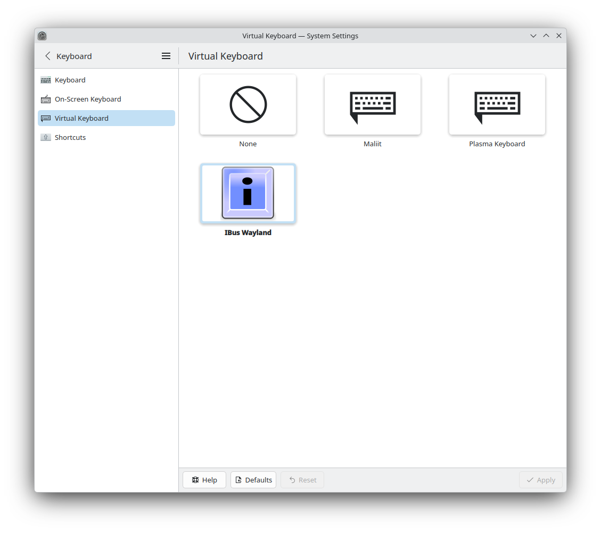
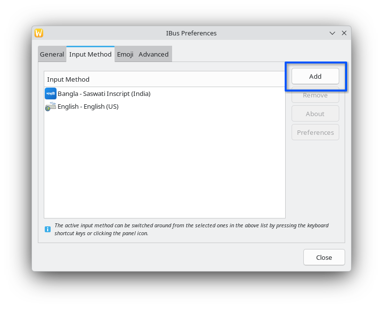
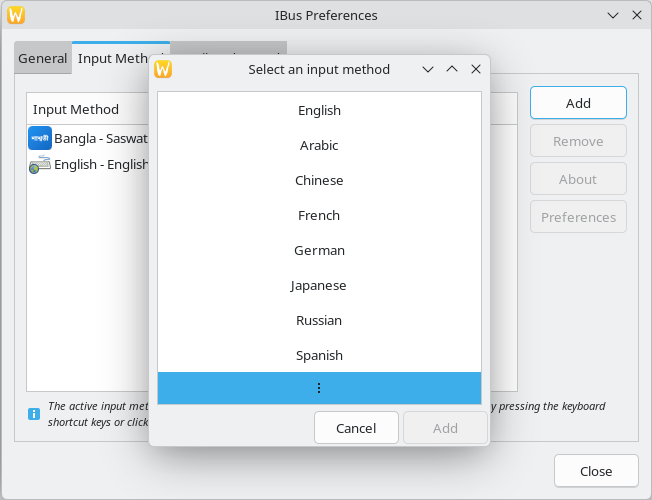
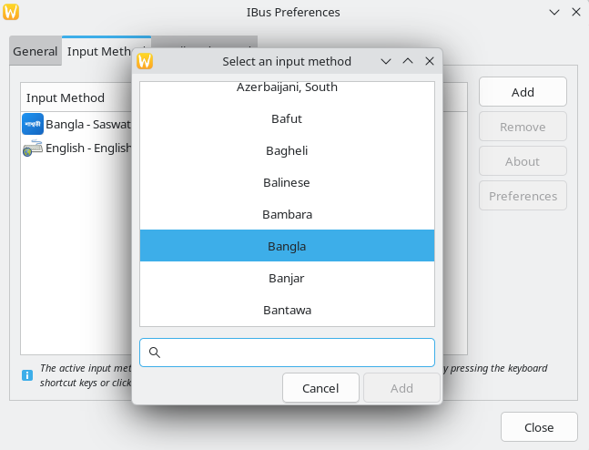
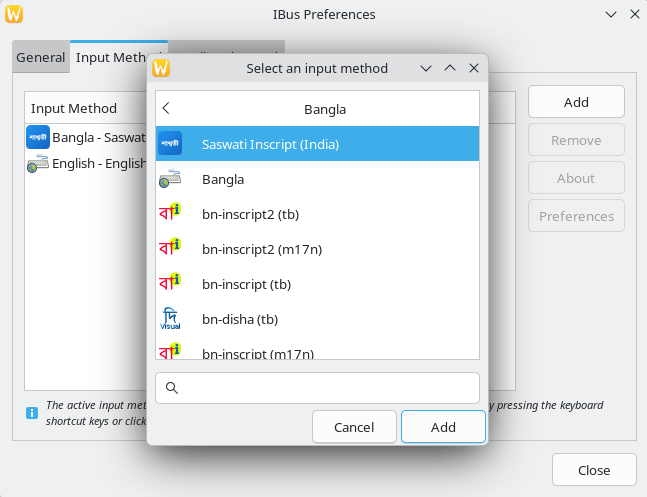
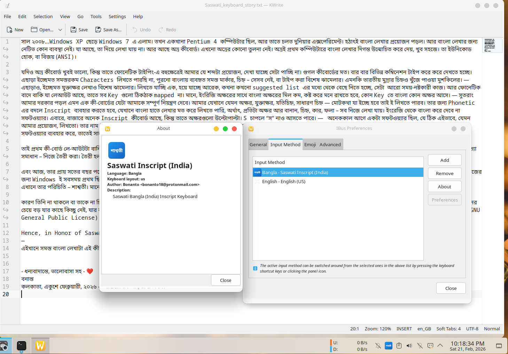
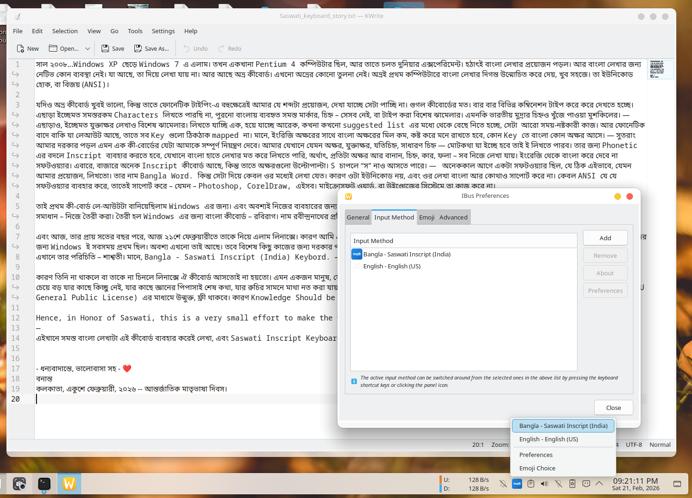
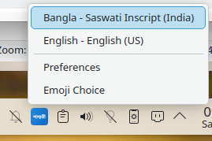
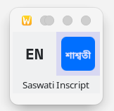
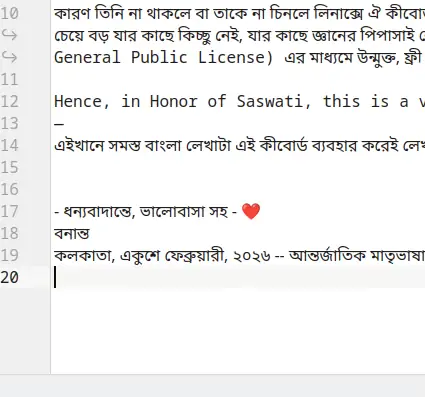

# Saswati (শাশ্বতী) - Bengali Inscript Keyboard for Linux

[](https://www.gnu.org/licenses/gpl-3.0)
[]()
[]()

**Saswati** is a comprehensive Bengali (Bangla) keyboard layout for Linux with full support for conjunct characters, designed for seamless typing in the Bengali script on any Linux distribution.

## 🌟 Features

### ✨ Complete Bengali Support
- **Full conjunct character support** - Type complex Bengali conjuncts like ক্ষ, জ্ঞ, ড্ড with single keypresses
- **All Bengali characters** - Complete coverage of Bengali Unicode characters
- **Bengali numerals** - Native Bengali digits (০-৯) with standard NumPad (0-9)
- **Special characters** - Full support for Bengali punctuation and special symbols

### 🎯 Smart Keyboard Behavior
- **Four-layer key mapping** - Normal, Shift, AltGr (Right Alt), and AltGr+Shift layers
- **CapsLock immunity** - CapsLock has NO effect on typing (works same whether on or off)
- **Empty layer blocking** - Undefined key combinations produce no output (prevents accidental characters)
- **Intelligent modifier handling** - System shortcuts (Ctrl, Alt) work normally

### 🖥️ Universal Linux Compatibility
- **All major distributions** - Ubuntu, Debian, Fedora, RHEL, CentOS, Arch, Manjaro, openSUSE, and more
- **All desktop environments** - GNOME, KDE Plasma, XFCE, Cinnamon, MATE, Budgie, LXQt
- **X11 and Wayland** - Automatic detection and configuration for both session types
- **Auto-dependency installation** - Automatically installs required packages

### 🔧 Professional Installation
- **Automatic detection** - Detects your OS, desktop environment, and session type
- **Smart configuration** - Configures AltGr (Right Alt) properly for X11/Wayland
- **No warnings** - Clean installation without environment variable conflicts
- **Custom icon** - Beautiful "শাশ্বতী" icon in IBus menu
- **One-command installation** - Simple curl/wget installation from GitHub

### 🎨 User Experience
- **Display name** - Shows as "Bangla - Saswati Inscript (India)" in keyboard selector
- **Seamless switching** - Use Super+Space or your preferred hotkey to switch layouts
- **No conflicts** - Cleans up old configurations automatically
- **Persistent AltGr** - Right Alt key works reliably across reboots

---

## 📖 The Story Behind Saswati (শাশ্বতী)  Keyboard

সাল ২০০৮...Windows XP ছেড়ে Windows 7 এ এলাম। তখন একখানা Pentium 4 কম্পিউটার ছিল, আর তাতে চলত দুনিয়ার এক্সপেরিমেন্ট। হঠাৎই বাংলা লেখার প্রয়োজন পড়ল। আর বাংলা লেখার জন্য নেটিভ কোন ব্যবস্থা নেই। যা আছে, তা দিয়ে লেখা যায় না। আর আছে অভ্র কীবোর্ড। এখনো অভ্রের কোনো তুলনা নেই। অভ্রই প্রথম কম্পিউটারে বাংলা লেখার দিগন্ত উন্মোচিত করে দেয়, খুব সহজে। তা ইউনিকোড হোক, বা বিজয় (ANSI)।

যদিও অভ্র কীবোর্ড খুবই ভালো, কিন্তু তাতে ফোনেটিক টাইপিং-এ বহুক্ষেত্রেই আমার যে শব্দটা প্রয়োজন, দেখা যাচ্ছে সেটা পাচ্ছি না। গুগল কীবোর্ডের মত। বার বার বিভিন্ন কম্বিনেশন টাইপ করে করে দেখতে হচ্ছে। এছাড়া ইচ্ছেমত সমস্তরকম Characters লিখতে পারছি না, পুরনো বাংলায় ব্যবহৃত সমস্ত মার্কার, চিহ্ন – সেসব নেই, বা টাইপ করা বিশেষ ঝামেলার। এমনকি ভারতীয় মুদ্রার চিহ্নও খুঁজে পাওয়া মুশকিলের। — এছাড়াও, ইচ্ছেমত যুক্তাক্ষর লেখাও বিশেষ ঝামেলার। লিখতে যাচ্ছি এক, হয়ে যাচ্ছে আরেক, কখনা কখনো suggested list এর মধ্যে থেকে বেছে নিতে হচ্ছে, সেটা আরো সময়-নষ্টকারী কাজ।
আর ফোনেটিক বাদে বাকি যা লেআউট আছে, তাতে সব Key গুলো ঠিকঠাক mapped না। মানে, ইংরিজি অক্ষরের সাথে বাংলা অক্ষরের মিল কম, কষ্ট করে মনে রাখতে হবে, কোন Key তে বাংলা কোন অক্ষর আসে।
— সুতরাং আমার দরকার পড়ল এমন এক কী-বোর্ডের যেটা আমাকে সম্পূর্ণ নিয়ন্ত্রণ দেবে। আমার যেখানে যেমন অক্ষর, যুক্তাক্ষর, যতিচিহ্ন, সাধারণ চিহ্ন — মোটকথা যা ইচ্ছে হবে তাই ই লিখতে পারব। তার জন্য Phonetic এর বদলে Inscript ব্যবহার করতে হবে, যেখানে বাংলা হাতে লেখার মত করে লিখতে পারি, অর্থাৎ, প্রতিটা অক্ষর আর বানান, চিহ্ন, কার, ফলা – সব নিজে লেখা যায়। ইংরেজি থেকে বাংলা করে দেবে না সফটওয়্যার। 
এবারে, বাজারে অনেক Inscript কীবোর্ড আছে, কিন্তু তাতে অক্ষরগুলো উল্টোপাল্টা। S চাপলে “স” নাও আসতে পারে। — অনেককাল আগে একটা সফটওয়্যার ছিল, যে ঠিক এইভাবে, যেমন আমার প্রয়োজন, লিখতো। তার নাম Bangla Word. কিন্তু সেটা দিয়ে কেবল ওর মধ্যেই লেখা যেত। কারণ ওটা ইউনিকোড নয়, এবং ওর লেখা বাংলা আর কোথাও সাপোর্ট করে না। কেবল ANSI যে যে সফটওয়্যার ব্যবহার করে, তাতেই সাপোর্ট করে – যেমন – Photoshop, CorelDraw, এইসব। মাইক্রোসফট ওয়ার্ড, বা উইন্ডোজের সিস্টেমে তা কাজ করে না।

তাই প্রথম কী-বোর্ড লে-আউটটা বানিয়েছিলাম Windows এর জন্য। এবং অবশ্যই নিজের ব্যবহারের জন্য। কারণ দ্রুত নির্ভুল বাংলা টাইপের জন্য আর কোনো সফটওয়্যার আমার প্রয়োজন মেটাতে পারেনি। অগত্যা সমাধান – নিজে তৈরী করা। তৈরী হল Windows এর জন্য বাংলা কীবোর্ড – রবিরাগ। নাম রবীন্দ্রনাথের প্রতি ভালোবাসার কারণে। সেটা সাল ২০০৮।

এবং আজ, তার প্রায় সতের বছর পরে, আজ ২১শে ফেব্রুয়ারীতে তাকে নিয়ে এলাম লিনাক্সে। কারণ আমি এতদিন আমার রোজকার কাজের জন্য লিনাক্স ব্যবহার করিনি। তা ছিল কেবল এক্সপেরিমেন্টের জন্য। কাজের জন্য Windows ই সবসময় প্রথম ছিল। অবশ্য এখনো তাই আছে। তবে বিশেষ কিছু কাজের জন্য দরকার পড়ে গেল। ফলাফল পাইথন ব্যবহার করে, রবিরাগের পোর্ট এল লিনাক্সে, আর, তার নাম গেল পাল্টে।
এখানে তার পরিচিতি – **শাশ্বতী**। মানে, Bangla - Saswati Inscript (India) Keybord. — কেন এই নাম?
কারণ তিনি না থাকলে বা তাকে না চিনলে লিনাক্সে ঐ কীবোর্ড আসতোই না হয়তো। এমন একজন মানুষ, যে প্রতিনিয়ত হাজার লড়াই করেও নিজের পথ, শিক্ষা, আদর্শ থেকে এক পা বিচ্যুত হয়নি, শিক্ষা, আর জ্ঞানের চেয়ে বড় যার কাছে কিচ্ছু নেই, যার কাছে জ্ঞানের পিপাসাই শেষ কথা, যার রুচির সামনে মাথা নত করা যায় সসম্মানে, সে এইটুকু সম্মান ডিজার্ভ করে। — এবং এই একই কারণে, এই কীবোর্ড সকলের জন্য GPL (GNU General Public License) এর মাধ্যমে উন্মুক্ত, ফ্রী থাকবে। কারণ Knowledge Should be Free...জ্ঞান ও ভাষা চির-উন্মুক্ত হওয়াই বাঞ্ছনীয়!

Hence, in Honor of Saswati, this is a very small effort to make the world better. To make education a little better.
—
এইখানে সমস্ত বাংলা লেখাটা এই কীবোর্ড ব্যবহার করেই লেখা, এবং Saswati Inscript Keyboard এর প্রথম লেখা। এবং সফল টেস্টিং।

 ধন্যবাদান্তে, ভালোবাসা সহ - ❤️  
 বনান্ত  
 কলকাতা, একুশে ফেব্রুয়ারী, ২০২৬ -- আন্তর্জাতিক মাতৃভাষা দিবস।  

**For Windows Users:** The original Windows version of this keyboard, Rabiraag, is available here: [Rabiraag - Windows Bengali Keyboard](https://github.com/bonanto/rabiraag)

---

## 📋 Requirements

### System Requirements
- **Operating System**: Any modern Linux distribution (2020+)
- **Python**: Python 3.6 or higher
- **IBus**: Version 1.5.0 or higher
- **Memory**: Minimal (< 10 MB)

### Distribution-Specific Packages
Automatically installed by the installer:

**Debian/Ubuntu-based:**
- `python3-gi`
- `gir1.2-ibus-1.0`
- `ibus`
- `librsvg2-bin`
- `imagemagick`

**Fedora/RHEL-based:**
- `python3-gobject`
- `ibus`
- `librsvg2-tools`
- `ImageMagick`

**Arch-based:**
- `python-gobject`
- `ibus`
- `librsvg`
- `imagemagick`

---

## 🚀 Quick Installation

### One-Command Installation (Recommended)

```bash
# Download and run installer
curl -fsSL [https://raw.githubusercontent.com/bonanto/saswati-keyboard/main/install.sh](https://raw.githubusercontent.com/bonanto/saswati-keyboard/main/install.sh) | sudo bash
```

Or using wget:

```bash
wget -qO- [https://raw.githubusercontent.com/bonanto/saswati-keyboard/main/install.sh](https://raw.githubusercontent.com/bonanto/saswati-keyboard/main/install.sh) | sudo bash
```

### Manual Installation

```bash
# Clone the repository
git clone [https://github.com/bonanto/saswati-keyboard.git](https://github.com/bonanto/saswati-keyboard.git)
cd saswati-keyboard

# Method 1: Make scripts executable and run (Standard)
chmod +x install.sh uninstall.sh
sudo ./install.sh

# Method 2: Run directly via bash (Use if Method 1 fails)
sudo bash install.sh
```

### Post-Installation Setup

1. **Restart your computer** (important!)
2. **Enable IBus** in System Settings (see [Setup Guide](SETUP_GUIDE.md))
3. **Add Saswati keyboard** to your input sources
4. **Switch layouts** using Super+Space

For detailed setup instructions, see [SETUP_GUIDE.md](SETUP_GUIDE.md)

---

## 📖 Documentation

- **[Setup Guide](SETUP_GUIDE.md)** - Complete installation and configuration guide
- **[Key Mappings](KEY_MAPPINGS.md)** - Full keyboard layout reference
- **[License](LICENSE)** - GPL v3.0 license information

---

## 🐛 Troubleshooting

Keyboard not appearing in list

```bash
# Restart IBus
pkill ibus-daemon
ibus-daemon -drxR --panel disable &  # For Wayland
# or
ibus-daemon -drxR &  # For X11
```

AltGr not working

```bash
# For X11:
setxkbmap -option lv3:ralt_switch

# For Wayland (KDE):
# System Settings → Keyboard → Advanced → "Key to choose 3rd level" → Right Alt
```

CapsLock still affecting typing

Update to the latest version and reinstall.

For more troubleshooting, see [Troubleshooting](https://github.com/bonanto/saswati-keyboard/blob/main/SETUP_GUIDE.md#troubleshooting)

---

## 🎯 Quick Start

After installation and restart:

```
Type: q     → ক্ষ (conjunct)
Type: k     → ক
Type: Shift+K → খ
Type: AltGr+g → জ্ঞ (conjunct)
Type: 1-9   → ১-৯ (Bengali numerals)
```

**CapsLock behavior:**
```
CapsLock ON + k     → ক (works normally!)
CapsLock ON + Shift+K → ক (cancel out)
```

---

## 🔧 Supported Systems

### ✅ Tested Distributions
- Ubuntu 20.04, 22.04, 24.04
- Debian 11, 12
- Fedora 38, 39, 40
- RHEL 8, 9
- CentOS Stream 8, 9
- Arch Linux (current)
- Manjaro (current)
- Linux Mint 21, 22
- Pop!_OS 22.04
- openSUSE Leap, Tumbleweed

### ✅ Tested Desktop Environments
- GNOME 40+ (X11 and Wayland)
- KDE Plasma 5.24+ (X11 and Wayland)
- XFCE 4.16+
- Cinnamon 5.0+
- MATE 1.26+
- Budgie 10.6+
- LXQt 1.0+

---

## 🗑️ Uninstallation

```bash
# If you cloned the repository locally
cd saswati-keyboard

# Method 1: Make script executable and run (Standard)
chmod +x uninstall.sh
sudo ./uninstall.sh

# Method 2: Run directly via bash (Use if Method 1 fails)
sudo bash uninstall.sh

# Alternatively, download and run without cloning
curl -fsSL [https://raw.githubusercontent.com/bonanto/saswati-keyboard/main/uninstall.sh](https://raw.githubusercontent.com/bonanto/saswati-keyboard/main/uninstall.sh) | sudo bash
```

Then remove the keyboard from your System Settings and **Restart**.

---

## 🤝 Contributing

Contributions are welcome! Please feel free to submit issues or pull requests.

### How to Contribute
1. Fork the repository
2. Create your feature branch (git checkout -b feature/AmazingFeature)
3. Commit your changes (git commit -m 'Add some AmazingFeature')
4. Push to the branch (git push origin feature/AmazingFeature)
5. Open a Pull Request

---

## 📜 License

This project is licensed under the **GNU General Public License v3.0** - see the [LICENSE](LICENSE) file for details.

### What this means:
- ✅ **Free to use** - Use for any purpose
- ✅ **Free to modify** - Adapt to your needs
- ✅ **Free to distribute** - Share with others
- ⚠️ **Must credit** - Give credit to the original author
- ⚠️ **Share improvements** - Distribute modifications under GPL v3
- ⚠️ **Include license** - Include license and copyright notice

---

## 👨‍💻 Author

**Bonanto**
- Email: bonanto18@protonmail.com
- GitHub: [@bonanto](https://github.com/bonanto)

---

## 🙏 Acknowledgments

- IBus framework by the IBus team
- Bengali language community
- All contributors and testers

---

## 📊 Project Status

**Version:** 1.0.0  
**Status:** Stable  
**Last Updated:** February 2026

---

## ⭐ Show Your Support

If you find this project helpful, please give it a ⭐ on GitHub!

---

## 📸 Screenshots

### ⚙️ KDE Plasma Setup Guide

<div align="center">
  <figure>
    
    <br>
    <figcaption><i>Step 1: Locate IBus Preferences within KDE System Settings</i></figcaption>
  </figure>
</div>
<br>

**Adding Saswati to the IBus Menu:**

| Step 1: Access the IBus panel menu | Step 2: Click 'Add' to find new layouts |
| :---: | :---: |
|  |  |
| **Step 3: Search for and select Bengali** | **Step 4: Choose 'Saswati Inscript (India)'** |
|  |  |

<div align="center">
  <br>
  <b>After Applying Settings</b><br>
  
</div>
<br>

---

### ⌨️ Typing & Usage Examples

**Document Editors:**

**Document Editors:**

<div align="center">
  <b>KWrite Text Editor</b><br>
  
  <br>
  <i>Simple typing test in KWrite</i>
  <br><br><br>

  <b>OnlyOffice Document (Part 1)</b><br>
  
  <br>
  <i>Typing Bengali in OnlyOffice</i>
  <br><br><br>

  <b>OnlyOffice Document (Part 2)</b><br>
  
  <br>
</div>
<br>

**System Integration & Switching:**

<div align="center">

| KDE Notification Area | Static Switching Menu |
| :---: | :---: |
| <br>*Saswati indicator in the KDE panel* | <br>*Input method selector menu* |

</div>
<div align="center">
  <br>
  <b>Seamless Live Switching (Super+Space)</b><br>
  
  <br>
  <figcaption><i>Animated demonstration of switching layouts instantly</i></figcaption>
</div>

---

**শুভেচ্ছা! Happy typing in Bengali! 🇮🇳**
